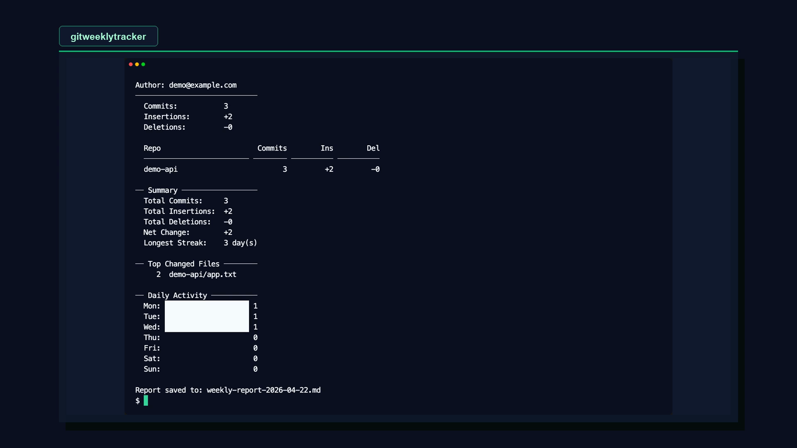

# Git Weekly Report

A single Bash script that generates a weekly git activity report across all your repositories, grouped by author email.

## Demo

[](demo/pipeline/output/gitweeklytracker-demo.mp4)

Watch the demo video: [gitweeklytracker-demo.mp4](demo/pipeline/output/gitweeklytracker-demo.mp4)

## How it works

1. Set your git author email(s)
2. The script auto-discovers every git repo on your machine that has commits from those emails
3. Generates a report with per-email, per-repo insertions/deletions breakdown

Output goes to both the terminal and a `weekly-report-YYYY-MM-DD.md` markdown file.

## Quick start

```bash
cp .env.example .env
# Edit .env with your email(s)
bash git-weekly-report.sh
```

Or pass the email inline:

```bash
GIT_REPORT_EMAILS="you@example.com" bash git-weekly-report.sh
```

## Configuration

All config is via environment variables, optionally loaded from a `.env` file.

### `GIT_REPORT_EMAILS` (required)

Comma-separated git author emails to include in the report.

```
GIT_REPORT_EMAILS="user1@example.com,user2@example.com"
```

### `GIT_REPORT_REPOS` (optional)

Comma-separated paths to repos or parent directories. If unset, all repos under `$HOME` are auto-discovered and filtered to those with commits from the configured emails.

```
GIT_REPORT_REPOS="~/projects/my-app,~/work"
```

Each path can be a git repo directly, or a parent directory whose immediate children are scanned for repos.

## Report contents

- **Per-email breakdown** with a table per author showing commits, insertions, and deletions for each repo (with subtotals)
- **Summary** of total commits, insertions, deletions, net change, and longest streak
- **Top 10 most-changed files** across all authors and repos
- **Daily activity** bar chart (terminal) / table (markdown)

Reports cover a rolling seven-day interval with UTC start and end times. Daily
Git activity and commit streaks also use UTC dates, regardless of the machine's
timezone or the author's original offset. Consecutive UTC dates remain a streak
across daylight-saving changes.

The optional Python dashboard (`python dashboard.py`, after installing
`requirements.txt`) adds Claude Code usage analytics. Its daily token totals
include the partial first day of the rolling interval, so a seven-day report can
show eight UTC calendar dates. Future-dated records are excluded. Timestamps
without an offset are treated as UTC; hourly activity is shown in local time.
If live usage quotas are unavailable or invalid, the dashboard uses the latest
valid cached quota entry when one exists.

## Requirements

- Bash 3.2+ (ships with macOS)
- Git
- Works on macOS and Linux (handles both `date` flavors)

## Tests

Run the offline regression suite with Python 3.11+ and Git:

```bash
python -m unittest discover -s tests -v
```

Tests use temporary repositories and synthetic analytics files, mock all HTTP
calls, and do not read your local Claude history or credentials. CI also checks
Python and Bash syntax.
