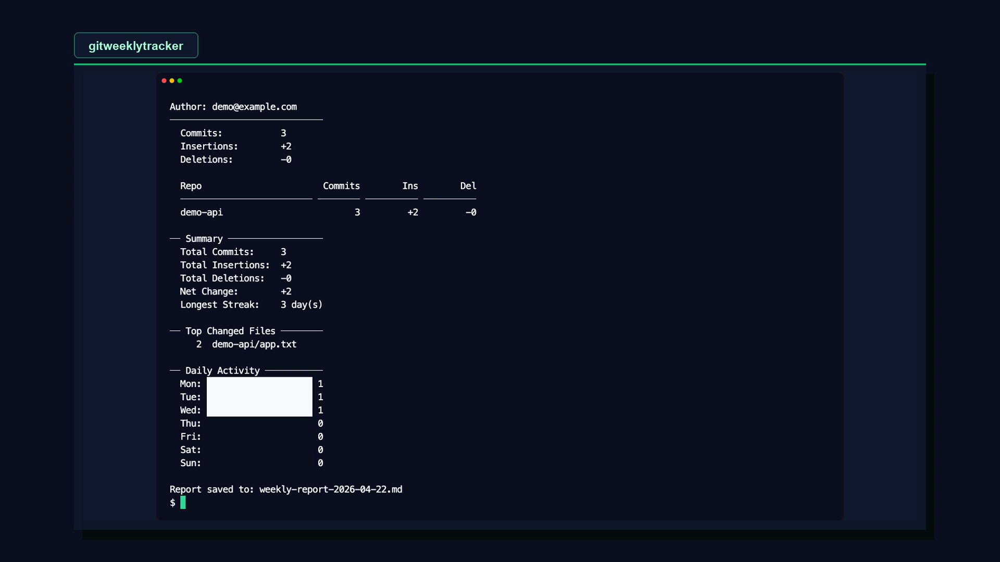

# Git Weekly Report

A weekly Git activity report across your repositories, grouped by author email.
Rust handles repository discovery, bounded Git commands, statistics, UTC daily
activity and streaks. The Bash entry point and Python presentation layer produce
the terminal and Markdown reports. The optional Python dashboard uses the same
Rust processor through its existing `GitAnalytics` data contract.

## Demo

[](demo/pipeline/output/gitweeklytracker-demo.mp4)

Watch the demo video: [gitweeklytracker-demo.mp4](demo/pipeline/output/gitweeklytracker-demo.mp4)

## How it works

1. Set your git author email(s)
2. The script auto-discovers every git repo on your machine that has commits from those emails
3. Generates a report with per-email, per-repo insertions/deletions breakdown

Output goes to both the terminal and a `weekly-report-YYYY-MM-DD.md` markdown file.

## Quick start

```bash
cargo build --release --locked --offline
GIT_REPORT_EMAILS="you@example.com" bash git-weekly-report.sh
```

Or save configuration next to the script in `.env`:

```bash
GIT_REPORT_EMAILS="you@example.com"
GIT_REPORT_REPOS="~/projects/my-app,~/work"
```

Build once after checkout or a Rust source update. Reports execute the compiled
binary once per invocation; they do not run Cargo or install anything. The core
uses only the Rust standard library and the installed Git executable.

## Configuration

All config is via environment variables, optionally loaded from a `.env` file.

### `GIT_REPORT_EMAILS` (required)

Comma-separated git author emails to include in the report.

```
GIT_REPORT_EMAILS="user1@example.com,user2@example.com"
```

### `GIT_REPORT_REPOS` (optional)

Comma-separated paths to repos or parent directories. If unset, all repos under `$HOME` are auto-discovered and filtered to those with commits from the configured emails.

```
GIT_REPORT_REPOS="~/projects/my-app,~/work"
```

Each path can be a git repo directly, or a parent directory whose immediate children are scanned for repos.
Paths containing spaces are supported, including Git repositories with a `.git`
file. Aliases and overlapping directories are deduplicated by canonical path.
Automatic discovery searches at most five levels below `$HOME`, excluding
`node_modules`, `.cache`, `Library`, `.Trash`, `.cargo` and `.rustup`. Git author
filters retain Git's regular-expression matching semantics.

### `GIT_TRACKER_BIN` (optional)

Path to a compiled `gitweeklytracker-core` executable. The default is
`target/release/gitweeklytracker-core` inside this project, independent of the
current working directory. Set this when using a custom `CARGO_TARGET_DIR` or
an installed binary. A missing processor reports the build command rather than
silently selecting a different implementation.

For a reproducible report, the presentation command also accepts an explicit end
time (a timestamp without an offset is treated as UTC):

```bash
GIT_REPORT_EMAILS="you@example.com" GIT_REPORT_REPOS="/path/to/fixture" \
  python3 git_report.py --now 2026-10-22T12:00:00Z
```

## Report contents

- **Per-email breakdown** with a table per author showing commits, insertions, and deletions for each repo (with subtotals)
- **Summary** of total commits, insertions, deletions, net change, and longest streak
- **Top 10 most-changed files** across all authors and repos
- **Daily activity** bar chart (terminal) / table (markdown)

Reports cover a rolling seven-day interval with UTC start and end times. Daily
Git activity and commit streaks also use UTC dates, regardless of the machine's
timezone or the author's original offset. Consecutive UTC dates remain a streak
across daylight-saving changes.
Git's existing commit-window semantics are retained: selection uses committer
timestamps, while daily activity and streaks use author timestamps normalized to
UTC. Merge commits count as commits; their file statistics follow the default
`git log` merge-diff behavior. Renames, binary files and unusual filenames use
Git's statistics and NUL-delimited file output. File rankings retain the Python
API's first-seen ordering for equal counts.

Each Git command has a ten-second timeout covering both process and stdout
completion, including a detached helper retaining the pipe. Unreadable, empty, failed or timed-out
repositories contribute no activity for the failed command, and scanning
continues. Only the owned Git process group is terminated; detached peers are not
targeted. An
explicit empty repository still counts as scanned. The dashboard returns an
empty analytics result when discovery finds no repositories; the report command
exits with an error, matching its existing behavior. Dashboard progress callbacks
mark the beginning and end of the Rust scan.

The Rust/Python JSON protocol always uses UTF-8, independent of the locale.
Analytics retain raw filenames; terminal, dashboard and Markdown displays escape
control characters and line separators into visible text.

The optional Python dashboard (`python dashboard.py`, after installing
`requirements.txt`) adds Claude Code usage analytics. Its daily token totals
include the partial first day of the rolling interval, so a seven-day report can
show eight UTC calendar dates. Future-dated records are excluded. Timestamps
without an offset are treated as UTC; hourly activity is shown in local time.
If live usage quotas are unavailable or invalid, the dashboard uses the latest
valid cached quota entry when one exists.

## Requirements

- Bash 3.2+ (ships with macOS)
- Git
- Python 3.11+ (standard library for the Git report; `requirements.txt` for the dashboard)
- Rust 1.85+ and Cargo to build the processor
- macOS or Linux

## Tests

Build the processor, then run the same offline checks used in CI:

```bash
cargo fmt --all --check
cargo clippy --all-targets --locked --offline -- -D warnings
cargo test --locked --offline
cargo build --release --locked --offline
python -m py_compile claude_analytics.py dashboard.py git_tracker.py git_report.py
python -m unittest discover -s tests -v
bash -n git-weekly-report.sh
```

For custom build output, export `GIT_TRACKER_BIN` before running the Python suite.
Tests fail with a build instruction if the binary is absent; they never compile
implicitly. Tests use temporary repositories and isolated homes, synthetic
analytics fixtures, and mock HTTP calls. They do not read local Claude history
or credentials, invoke the interactive dashboard, or query live quotas.
